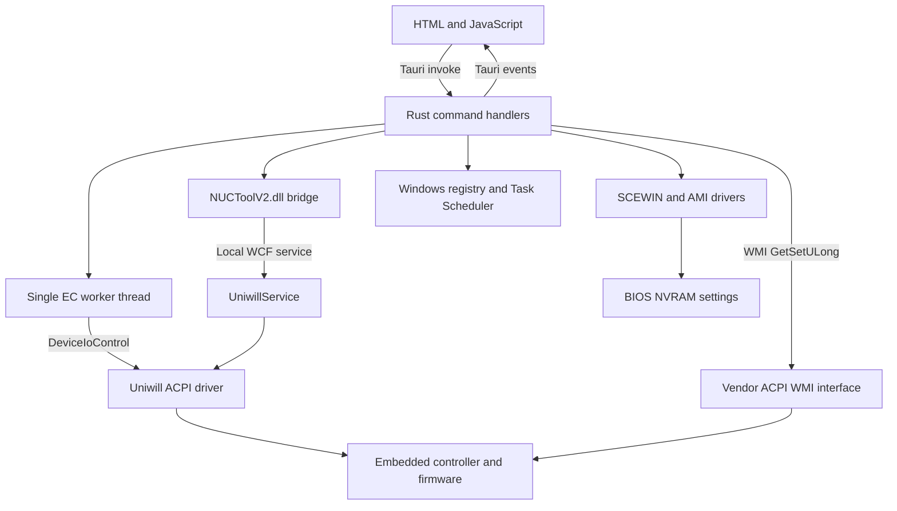

> Historical audit of the upstream Tauri implementation. The current native edition is documented in [native-backend.md](native-backend.md) and the [README](../README.md).

# How NUCtool controls the computer

This describes the Windows application at Git commit `97246897e9b38a7a30af0d7abecb7445baa0118e` (version `1.1.5`), inspected on October 26, 2026. It follows the executable code, including behavior that differs from comments or button labels. No application, driver, fan, power, battery, or BIOS settings were changed during the investigation.

For the installed Intel NUC Software Studio, its service implementation, this laptop's compatibility, and opportunities for a combined application, see [Software Studio comparison](software-studio-comparison.md).

## 1. Overall architecture

NUCtool is a Tauri desktop application: HTML and JavaScript run in a WebView, while Rust performs privileged operations. The embedded controller (EC) is the laptop controller whose registers hold temperatures, fan state, power limits, and other platform settings. NUCtool reaches it through vendor interfaces; it does not implement a kernel driver.



The service-to-driver edge is confirmed by inspecting the installed Uniwill service, as described in the comparison. It is not implemented in this repository.

| Layer | Source | Responsibility |
| --- | --- | --- |
| UI and callers | [bootstrap.js](https://github.com/cyear/NUCtool/blob/97246897e9b38a7a30af0d7abecb7445baa0118e/src/bootstrap.js), [main.js](https://github.com/cyear/NUCtool/blob/97246897e9b38a7a30af0d7abecb7445baa0118e/src/js/main.js), [bios.js](https://github.com/cyear/NUCtool/blob/97246897e9b38a7a30af0d7abecb7445baa0118e/src/js/bios.js) | Load pages, edit curves, invoke commands, display returned data/events. |
| Command boundary | [lib.rs](https://github.com/cyear/NUCtool/blob/97246897e9b38a7a30af0d7abecb7445baa0118e/src-tauri/src/lib.rs) | Register Tauri commands, route requests, run monitoring/control threads, handle startup and exit. |
| Direct EC access | [uniwillacpi.rs](https://github.com/cyear/NUCtool/blob/97246897e9b38a7a30af0d7abecb7445baa0118e/src-tauri/src/acpi/uniwillacpi.rs) | Open the driver, encode IOCTL requests, read/write registers. |
| EC serialization | [acpi_ec_worker.rs](https://github.com/cyear/NUCtool/blob/97246897e9b38a7a30af0d7abecb7445baa0118e/src-tauri/src/acpi/acpi_ec_worker.rs) | Execute this process's direct EC operations on one thread. |
| WMI access | [uniwillwmi.rs](https://github.com/cyear/NUCtool/blob/97246897e9b38a7a30af0d7abecb7445baa0118e/src-tauri/src/acpi/uniwillwmi.rs) | Vendor firmware commands and ordinary Windows model/driver queries. |
| Service bridge | [uniwillwcf.rs](https://github.com/cyear/NUCtool/blob/97246897e9b38a7a30af0d7abecb7445baa0118e/src-tauri/src/acpi/uniwillwcf.rs) | Load C ABI functions from the bundled DLL. |
| Files and fan math | [config.rs](https://github.com/cyear/NUCtool/blob/97246897e9b38a7a30af0d7abecb7445baa0118e/src-tauri/src/config.rs), [fan_control.rs](https://github.com/cyear/NUCtool/blob/97246897e9b38a7a30af0d7abecb7445baa0118e/src-tauri/src/fan_control.rs) | Store curves and calculate software-controlled speeds. |

## 2. How the frontend requests an operation

The frontend obtains `invoke` from `window.__TAURI__.core`. For example, a power-limit button calls:

```javascript
await invoke("set_tdp", { tdpType: "cpu-pl1", value: 65 });
```

Tauri deserializes those arguments into Rust's `set_tdp(app, tdp_type: String, value: u8)`. The handler submits an EC job that calls `cpu_write_pl1(65)`, which writes register `0x0783`. The number is passed as a byte in the application's watts convention. This example explains the message format; it is not a recommended setting.

Commands are registered in `tauri::generate_handler!` inside `run()`. Rust returns serializable values or `Result` errors. Background work uses events: `sensor-update`, `fan-control-status`, and `newfan-status`. The frontend subscribes through `window.__TAURI__.event.listen`.

The UI does not itself open hardware devices. However, a resolved `invoke` promise is not necessarily proof that a hardware change succeeded: several handlers suppress lower-level errors or do not check vendor return values.

## 3. Direct driver communication

`UniwillAcpiEc::open()` uses Windows `CreateFileW` to open `\\.\ACPIDriver` for read/write access, sharing it for other readers and writers. The installed driver on the inspected machine is `UWACPIDriver.sys`; its internals are outside the Rust source.

| Operation | IOCTL | Input buffer | Output |
| --- | --- | --- | --- |
| Read one EC byte | `0x9C40A488` | Address as a little-endian `u32` (4 bytes). | A `u32`; NUCtool keeps the low 8 bits. |
| Write one EC byte | `0x9C40A48C` | Address as a little-endian `u32`, then value as a little-endian `u32` (8 bytes). | A `u32` that NUCtool ignores. |

For the `0x0783 = 65` example, the write input is `83 07 00 00 41 00 00 00`. Each successful `write_u8` sleeps for 6 ms. Fan-table operations add further 10 ms sleeps between many writes.

`AcpiEcWorker` owns a lazily opened driver handle and receives closures over an `mpsc` channel. A caller blocks waiting for its result. A batch such as a complete fan-table write occupies the worker until it finishes, so sensor work queues behind it. Failed opening can be retried on the next job. There is no receive timeout or automatic reopen on every ordinary I/O error.

This queue serializes direct EC access **inside NUCtool only**. It does not coordinate with UniwillService, other processes, or NUCtool's separate WMI calls. Its `catch_unwind` recovery cannot recover an aborting panic in the configured release profile (`panic = "abort"`).

## 4. WMI firmware communication

`UniwillWmiEc::new()` opens `ROOT\WMI`, queries `SELECT * FROM AcpiTest_MULong`, and keeps the first instance's WMI path. `get_set(data)` calls that instance's `GetSetULong` method with `Data` as an unsigned 64-bit integer, then reads a 32-bit `Return` value.

The legacy fan controller uses these packed requests:

| Destination | Encoded `Data` |
| --- | --- |
| Secondary/GPU fan | `((speed_percent * 2) << 16) | 0x1809` |
| Main/CPU fan | `((speed_percent * 2) << 16) | 0x1804` |

A 60% main-fan request is therefore `0x0000000000781804`. The application uses a 0–200 duty scale for 0–100%; it sends duty requests rather than requesting a target RPM.

Separately, ordinary inventory queries use `ROOT\CIMV2`: `Win32_ComputerSystemProduct` for the model and `Win32_PnPSignedDriver` for display/GSC driver versions. Those queries do not use the proprietary fan command format.

## 5. Monitoring temperatures, fan speeds, power, and battery capacity

The frontend calls `start_sensor_loop` once. The backend prevents duplicate sensor loops, first reads two battery values through WMI, then starts its EC polling thread.

| Event field | Source | Conversion / interpretation |
| --- | --- | --- |
| `cpu_temp` | EC `0x043E` | Raw byte displayed as degrees Celsius. |
| `gpu_temp` | EC `0x044F` | Raw byte displayed as degrees Celsius. |
| `fan1_rpm` | EC `0x0464`, `0x0465` | `(high << 8) | low`, returned directly as main-fan RPM. |
| `fan2_rpm` | EC `0x046C`, `0x046D` | Same combination for secondary-fan RPM. |
| `system_power` | EC `0x044C` | Raw byte displayed as power/APC_WATT. The source labels the watt interpretation as suspected; it does not establish whether this is wall input, total system draw, or a component measurement. |
| `bat_mah_percent` | WMI `0x0000010000000404` divided by `0x0000010000000402` | Integer capacity ratio times 100, capped at 100; zero if the denominator is zero. Read once when the loop starts, then reused. |

The UI labels this ratio **Battery Health**, not battery charge percentage. The Rust variables are named `current_capacity` and `full_capacity`, but the code does not independently establish the firmware values' physical units. This one-time ratio is separate from the battery charge-limit setting and should not be treated as a live state-of-charge reading.

The loop emits `sensor-update` and sleeps 2.5 seconds after a successful sample. Individual EC read failures become zero. Failure to run the EC job causes a log and a 3-second retry delay. Consequently, a displayed zero can represent a failed read.

`window_push.rs` checks the main window every 250 ms. Sensor polling and the new-fan status monitor pause when the window is hidden or minimized; focus is not required. Hidden sensor polling sleeps in 3-second intervals. This gating does not stop the legacy fan-control thread or an already programmed EC curve.

## 6. The two fan controllers

Both use `FanData`, containing `left_fan` and `right_fan` arrays of `{ temperature: u8, speed: u8 }`. Despite these field names, the backend maps `left_fan` to the CPU/main curve and `right_fan` to the GPU/secondary curve. In the legacy loop, local variables called `left_speed` and `right_speed` use the opposite physical naming: `left_speed` is secondary/GPU and `right_speed` is main/CPU.

The normal editors create 15 points at 30, 35, …, 100°C, initially at 50%. Both editors share the same saved JSON file. Saving does not apply the curve to hardware.

### 6.1 Legacy: software loop and WMI duty commands

`start_fan_control` calls `start_fan_control_internal`:

1. Set an atomic running flag, reject a duplicate start, and spawn a thread owning a snapshot of the submitted curve.
2. Open the vendor WMI interface and call `fan_write_manual(false)` through the direct EC worker. Despite the helper name, this sets bit `0x40` in register `0x0751` for this control path.
3. Load the saved coupling mode: `0` independent, `1` main/CPU priority, `2` secondary/GPU priority. A missing file defaults to `1`.
4. Read CPU/GPU temperatures, calculate duties, send the two WMI commands, and sleep 2 seconds. If the mode bit was cleared, set it again. EC job failure causes a 1.5-second retry delay.

`calculate_speed` sorts points by temperature and linearly interpolates between neighbors, rounds to an integer, and clamps to 0–100%. Below/above the curve it uses the nearest endpoint. An empty curve returns 100%. This is not a feedback controller that adjusts output to achieve measured RPM.

The loop also contains temperature-change counters: a sample more than 2°C below or more than 5°C above its cached temperature increments the appropriate counter; recalculation occurs after that counter exceeds three. **The cached temperatures are not updated after initialization, and an in-range sample does not reset a counter.** This describes the implementation, not a guaranteed four-consecutive-sample hysteresis scheme.

If either temperature exceeds 98°C, both requested speeds become 99%. Coupling then either leaves them independent or copies the priority fan's duty to the other fan. Duty commands are sent every iteration, even if the calculated value did not change. A zero caused by a failed temperature read does not activate the thermal override.

`stop_fan_control` clears the flag, joins the thread, and calls `fan_write_manual(true)` to clear bit `0x40`. Normal application exit invokes this legacy stop routine. Editing/saving a curve or changing `fan_mode.txt` does not update an already running loop; it reads those inputs at startup.

### 6.2 New: program the EC's own fan tables

`start_newfan_write` calls `start_newfan`, which runs initialization and table programming as one queued EC job. There is no repeating Rust temperature-to-duty loop in this path. The design delegates subsequent curve execution to firmware.

Initialization performs these writes in order:

| Register | Action | Purpose assigned by the code |
| --- | --- | --- |
| `0x0751` | Clear bit `0x40`, preserving other bits. | Select the mode in which firmware tables can operate. |
| `0x0741` | Write `1`. | Split fan operation. |
| `0x07C5` | Write `0x80`. | Enable independent dual-fan table control. |
| `0x07C6` | Write `0x04`. | Enable custom fan tables. |
| `0x0F20`, `0x0F50` | Write `0`. | Set the initial duty entries. |

Several of these writes replace a whole register rather than preserving unrelated bits.

The table layout is:

| Table | Rising temperature base | Falling temperature base | Duty base |
| --- | --- | --- | --- |
| CPU/main | `0x0F00` | `0x0F10` | `0x0F20` |
| GPU/secondary | `0x0F30` | `0x0F40` | `0x0F50` |

For both fans, entry zero gets an upward threshold of 20°C, a downward threshold of 17°C, and the zero duty established during initialization. For indexes `1..15`, the corresponding submitted point supplies:

```text
up[ index ]   = temperature
down[ index ] = temperature - 3
duty[ index ] = speed_percent * 2
```

For example, a 65°C / 50% CPU point at index 8 writes 65 to `0x0F08`, 62 to `0x0F18`, and 100 to `0x0F28`. The differing up/down thresholds provide a 3°C hysteresis band in the programmed table. Exact firmware transition timing is not determined by the Rust code; it does not implement interpolation for this path.

The backend directly indexes the first 15 points. It does not validate length, sorting, minimum temperature, or a safe maximum duty before writing. Short arrays can panic; out-of-range arithmetic can overflow/underflow. There is no transaction, complete write verification, saved hardware snapshot, or rollback after a partial table write. The legacy 98°C override is not part of this path.

`start_newfan_monitor` polls every 3 seconds while the window allows it and emits `newfan-status`:

| Status field | Test |
| --- | --- |
| `mode` | `0x0751 & 0x40 == 0` |
| `independent` | `0x07C5 & 0x80 != 0` |
| `fan` | `0x07C6 & 0x04 != 0` |
| `duty` | Both entry-zero duty bytes are zero. |

These flags do not verify all curve entries or physical cooling. The UI shows a running state when all four are true, and chooses its Start/Stop action from the last three flags.

`stop_newfan_write` clears bit `0x40`, zeros the entry-zero up/down thresholds, disables the independent/table flags, writes `0xFF` to entry-zero duties, and clears the split setting. It does not restore a captured factory table. The normal exit handler only calls the legacy stop routine; it does not call this new-fan cleanup. Persistence through exit, sleep, or reboot requires hardware testing.

`set_fan_max` is a toggle of bit `0x40` in `0x0751`, with OSD labels for maximum/automatic mode. It does not write an explicit 100% command to both fans. There is no backend mutual exclusion preventing the two controllers from being started together.

## 7. Power consumption and power limits

NUCtool exposes three different mechanisms: monitoring the `0x044C` power byte, writing individual power-limit bytes, and applying service-managed performance/power profiles. Changing a limit is a request to firmware; it does not force the computer to consume that many watts.

`get_tdp` reads these registers and `set_tdp` writes them directly:

| `tdpType` argument | EC register | Returned field |
| --- | --- | --- |
| `cpu-pl1` | `0x0783` | `cpu_pl1` |
| `cpu-pl2` | `0x0784` | `cpu_pl2` |
| `cpu-pl4` | `0x0785` | `cpu_pl4` |
| `gpu-pl1` | `0x072D` | `gpu_pl1` |
| `gpu-pl2` | `0x072E` | `gpu_pl2` |
| `psys_pl1` | `0x0721` | `psys_pl1` |

The application treats each as a one-byte watt value, with no scaling on this path. The PSYS comments mention another byte at `0x0720`, but the active implementation only uses `0x0721`; it does not read or write a combined 16-bit value. Names such as PL1/PL2/PL4 come from the UI/source; their exact enforcement windows and interactions are firmware behavior, not configured here.

CPU read helpers replace a read error or raw zero with defaults of 65 W, 100 W, and 130 W respectively. Thus those displayed CPU values can be fallbacks. GPU/PSYS reads use `expect` instead. The setter's Rust `u8` limits the representation to integer values 0–255, but there are no model-specific safe bounds, cross-limit checks, or automatic readback. Unknown limit names are logged. EC job errors are logged and the handler still returns `Ok(())`.

The GPU controls are explicitly labeled Intel Arc in the UI. This laptop's RTX 3060 is not evidence that those same registers control its GPU power; see the comparison. The active Rust power-limit path does not call an NVIDIA API, Intel MSR interface, or the unused `arc.rs` file. `arc.rs` is not declared as a module in `acpi/mod.rs`.

## 8. Service bridge, performance modes, and Windows power plans

`UniwillWcfEc::new()` finds `dll\NUCtoolV2.dll` beside the executable, verifies its SHA-256, loads it with `libloading`, and resolves its `wcf_*` functions using the Windows C calling convention and C-compatible structures. The tracked binary is named `NUCToolV2.dll`; Windows path lookup is case-insensitive.

Expected and observed bundled DLL SHA-256:

```text
838E83709F1E2C45A470868F210EEF1A3A48EAE10E13DBA896905E6DAA387497
```

Handlers normally create a wrapper, call `connect()` with the fixed bridge key `NUCtool@cyear`, invoke functions, and sometimes explicitly disconnect. The wrapper has no `Drop` implementation that guarantees `disconnect()`. Many handlers merely print vendor return codes. DLL load failures often reach `expect` and can terminate the release application.

The DLL contains a WCF client targeting `ws://localhost:58594/UniwillService`, matching Software Studio's installed client configuration. This is local service IPC over WebSockets, not a public cloud control API. Native export bodies were not reliably decompiled, so the complete internal behavior of each bridge function is not claimed here.

| Requested performance string | DLL calls |
| --- | --- |
| `performance` | Disable benchmark, then `apply_profile(1)`. |
| `balanced` | Disable benchmark, then `apply_profile(2)`. |
| `power-saving` | Disable benchmark, then `apply_profile(3)`. |
| `benchmark-on` | Enable benchmark; do not select a normal profile. |

`get_performance_mode` reports `5` for benchmark or returns the selected profile index. These operations delegate the actual EC/OS changes to the service.

`set_power_plan` calls `wcf_set_power_plan`: `0` off, `1` high performance, `2` balanced, `3` power saving, `4` benchmark high performance. The bundled client contract contains `SetPowerPlan`, but the installed service contract inspected on this computer does not. Treat this as a compatibility issue until tested, rather than assuming the UI can switch Windows plans through this service version.

## 9. Battery, display, keyboard, and light bar

### Battery

The `get_battery_charging_level` / `set_battery_charging_level` commands use the DLL's battery charge-limit functions. `get_battery_mode` / `set_battery_mode` use mode values `0`, `1`, and `2` for full-charge/AC, custom, and best-battery behavior. These are service operations, separate from the capacity ratio displayed by the sensor loop. The installed service's actual register handling and its 100%/custom/65% mode policy are documented in the comparison.

### Display

`set_display_mode` uses the DLL. Modes `0..4` first enable display-mode management and select standard, gaming, video, reading, or custom mode. Mode `5` disables management. The Rust handler does not implement panel color adjustment itself or configure a GPU MUX. The installed service contains the display implementation behind these requests.

### Keyboard lighting

The current command handlers use direct EC writes plus writes to the Uniwill service's registry configuration, even though the DLL wrapper also defines keyboard functions.

| Setting | AC power register(s) | Battery/DC register(s) |
| --- | --- | --- |
| State, brightness, effect | `0x07EA` | `0x07EB` |
| Red, green, blue | `0x0769`, `0x076A`, `0x076B` | `0x07EC`, `0x07ED`, `0x07EE` |

State bit `0x10` means disabled and bit `0x20` means rainbow. Brightness occupies the low nibble: the writer uses `0x08 + brightness`, and the normal UI supplies values 0–4. The reader accepts both 1–4 and encoded `0x08..0x0C`. RGB values are raw 0–50 through the normal UI. Selecting AC/DC edits that stored profile; it does not switch the physical power source.

[keyboard_registry.rs](https://github.com/cyear/NUCtool/blob/97246897e9b38a7a30af0d7abecb7445baa0118e/src-tauri/src/win/keyboard_registry.rs) also writes under:

```text
HKLM\SYSTEM\CurrentControlSet\Services\UniwillService\SOFTWARE\Uniwill\RGBKeyboardSingleColor
```

It stores `Power`, `Effect`, `Light_AC`/`Light_DC`, and binary `Color_AC`/`Color_DC`. RGB is converted from 0–50 to 0–100. Despite older helper comments describing brightness conversion, the active `set_brightness` stores the supplied 0–4 value directly. EC and registry updates are separate, with errors commonly ignored; one can succeed while the other fails. This single-color layout is not established for every NUC model.

### Light bar

`get_lightbar_profile` / `set_lightbar_profile` call the DLL with separate AC/DC RGB/effect settings and a breathing-enable field. They do not write light-bar EC registers directly. The frontend skips the light-bar page for `LAPAC71H`/`LAPAC71G`; this is a model-name rule, not full feature discovery.

## 10. BIOS settings use a separate toolchain

The BIOS editor does not use the fan/power IOCTL protocol. Rust invokes bundled `SCEWIN_64.exe` with `amifldrv64.sys` and `amigendrv64.sys` present beside it. These binaries and the firmware implementation are outside the Rust source.

1. `read_bios_nvram` checks the files, removes the previous application backup, and runs `SCEWIN_64.exe /o /s nvram_bak.txt` in the DLL directory. It checks process success, reads the generated file, strips a UTF-8 BOM, requires `Setup Question`, and saves a copy to the application configuration directory.
2. The frontend parses that text and tracks edits. `export_nvram(text)` saves the modified text as `nvram.txt`; it only rejects empty input. Exporting creates a file, not a BIOS write.
3. `write_bios_nvram(password)` requires a nonempty BIOS administrator password and the previously saved `nvram.txt`, then runs `SCEWIN_64.exe /cpwd <password> /i /s <nvram.txt path>`. The frontend requests confirmation and the password. Edits must have been exported first because this command reads the saved file.

The password is passed as a process argument. Success means the utility returned a successful exit status; there is no post-write BIOS readback in this handler. This changes NVRAM configuration, not the BIOS image, and incorrect settings can prevent normal boot.

## 11. Startup, hotkeys, background lifetime, and storage

`main.rs` calls `nuctool_lib::run()`. Before creating Tauri, [permissions.rs](https://github.com/cyear/NUCtool/blob/97246897e9b38a7a30af0d7abecb7445baa0118e/src-tauri/src/win/permissions.rs) checks administrator membership with PowerShell. If needed, it relaunches the executable with `Start-Process -Verb RunAs` and exits. That relaunch does not forward the original command-line arguments.

The backend starts a low-level Windows keyboard hook (`WH_KEYBOARD_LL`). On this vendor keyboard, it recognizes Fn as virtual key `0xFF` with scan code `0x78`, then intercepts Fn plus digits. Fn+1/2/3 disable benchmark and apply performance/balanced/quiet profiles; Fn+4 enables benchmark. Fn+5..9 are intercepted but only logged. The tray also invokes service profile/benchmark actions.

| Flag / action | Behavior |
| --- | --- |
| `--hide` | Start with the main window hidden. |
| `--fan-control` | Load the saved curve; inspect custom-table flags at `0x07C5`/`0x07C6`; after 4 seconds start the new path if either flag was enabled, otherwise the legacy path. It does not select the controller from an explicit saved controller-type field. |
| `--no-osd` | Skip creating the on-screen notification window. |
| `--log` | Append ordinary backend logs to `NUCtool.log`. |
| Close main window | Hide it to the tray; keep the application running. |
| Quit / normal exit | Run the legacy fan stop routine. No corresponding new-fan cleanup or general power/lighting rollback is registered. |

[task.rs](https://github.com/cyear/NUCtool/blob/97246897e9b38a7a30af0d7abecb7445baa0118e/src-tauri/src/win/task.rs) implements autostart with a Task Scheduler task named `NUCtool`, triggered at the current user's logon, using the interactive token at the highest run level. Its action launches the current executable with `--hide --fan-control`.

The OSD is another Tauri WebView: Rust emits `osd-show`; JavaScript displays it for about one second. It is a notification mechanism, not independent evidence that firmware accepted a command.

Application files normally live under `%APPDATA%\com.cyear.nuctool` (`dirs::config_dir()` with a current-directory fallback):

| File | Contents |
| --- | --- |
| `fan_config.json` | Both fan curves. Missing/invalid data returns an error; the UI can show its defaults. |
| `fan_mode.txt` | Legacy coupling mode. |
| `nvram_bak.txt` | Copy of the last successfully parsed BIOS export. |
| `nvram.txt` | Saved BIOS settings to import. |
| `NUCtool.log` | Optional append-only ordinary log. |
| `crash_*.log` | Panic-hook reports, even without `--log`; old crash reports are pruned. |

Language selection is stored separately in WebView `localStorage` as `nuctool-language`. The UI also checks GitHub's latest-release endpoint; hardware commands use local interfaces. DLLs and BIOS helper binaries are looked up in `dll` beside the running executable, not in the configuration directory.

The repository additionally includes a Linux executable archive and `fan.json`. The README describes an `acpi_call` workflow. The archive contains no corresponding source, so this document does not claim that its implementation or registers match the Windows application.

## 12. Command inventory

All commands registered by this revision are accounted for below. Implementation details are in `lib.rs`, except the OSD commands in `osd.rs`.

| Area | Registered commands |
| --- | --- |
| Monitoring / identification | `start_sensor_loop`, `get_sys_model`, `get_sys_arc_gpu_driver`, `get_sys_gsc_driver` |
| Fan configuration | `load_fan_config`, `save_fan_config`, `get_fan_mode_file`, `set_fan_mode_file` |
| Legacy fan controller | `start_fan_control`, `stop_fan_control`, `get_fan_control_status` |
| EC fan tables | `start_newfan_monitor`, `start_newfan_write`, `stop_newfan_write`, `set_fan_max` |
| Performance / power | `set_performance_mode`, `get_performance_mode`, `set_power_plan`, `get_tdp`, `set_tdp` |
| Battery | `get_battery_charging_level`, `set_battery_charging_level`, `get_battery_mode`, `set_battery_mode` |
| Keyboard | `get_keyboard_led`, `set_keyboard_enabled`, `set_keyboard_brightness`, `set_keyboard_rainbow`, `set_keyboard_red`, `set_keyboard_green`, `set_keyboard_blue` |
| Light bar / display | `get_lightbar_profile`, `set_lightbar_profile`, `set_display_mode` |
| Startup / connection / OSD | `get_autostart`, `set_autostart`, `is_wcf_is_connect`, `osd_ready`, `show_osd_command` |
| BIOS | `read_bios_nvram`, `export_nvram`, `write_bios_nvram` |

## 13. What this investigation establishes

Source inspection establishes which values the application reads/writes, how it encodes them, and how it schedules work. It does not establish safe settings for another model, verify actual temperatures/RPM/watts, demonstrate persistence, or prove that a successful driver/service call changed the hardware. The installed service can also reapply its own settings on power-source changes and resume; it shares the same hardware with direct NUCtool writes. These limitations shape the [combined-application recommendations](software-studio-comparison.md#7-smallest-useful-combined-version).
