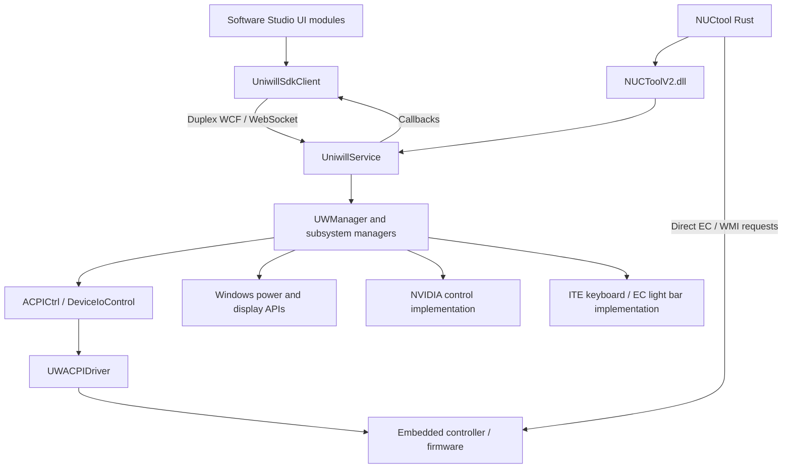

> Historical static comparison with upstream NUCtool. For the native rewrite and later read-only diagnostics, see [native-backend.md](native-backend.md) and [performance-investigation.md](performance-investigation.md).

# Intel NUC Software Studio: installed backend and comparison with NUCtool

Inspected October 26, 2026. This complements [How NUCtool controls the computer](backend-hardware-control.md), which documents repository commit `97246897e9b38a7a30af0d7abecb7445baa0118e`.

**Finding:** NUCtool already communicates with the same local Uniwill service used by Software Studio on this laptop. A combined application could expose more of that service and retain selected NUCtool controls. The code supports concrete opportunities in fan-table editing, independent AC/DC profiles, keyboard effects, telemetry, and display management. It does not demonstrate that firmware limits can be bypassed or that every discovered API works on this hardware.

## 1. What was inspected

This was a static, read-only inspection of installed application files, decompiled .NET assemblies, service/driver inventory, and repository code. No vendor application/service assemblies were loaded to execute their methods. No WCF operations or hardware IOCTLs were sent, no services were restarted, and no settings were written.

| Item | Observed installation |
| --- | --- |
| Computer model | Intel `LAPKC71E`, board/product version `M38561-402`. |
| BIOS | `KCTGL357.0051.2024.1218.1352`. |
| GPUs | NVIDIA GeForce RTX 3060 Laptop GPU and Intel UHD Graphics; Windows also lists a USB virtual display. |
| Store application | `AppUp.IntelNUCSoftwareStudio`, package version `1.44.25758.0`, x64. |
| Application root | `C:\Program Files\WindowsApps\AppUp.IntelNUCSoftwareStudio_1.44.25758.0_x64__8j3eq9eme6ctt\NucSoftwareStudio`. |
| Vendor service | `UniwillService`, observed running, executable `C:\Windows\System32\UniwillService\UniwillService.exe`. |
| Vendor driver | `UWACPIDriver`, observed running, `C:\Windows\System32\drivers\UWACPIDriver.sys`. |
| Separately installed NUCtool | Uninstall metadata lists version `0.4.4` under `%LOCALAPPDATA%\NUCtool`. This is distinct from the `1.1.5` source checkout analyzed here; its executable was not analyzed. |

Original vendor source is not provided with the installation. ILSpy command-line version `11.1.0.9782` was installed into the investigation's temporary directory and used to recover C# from managed assemblies. Decompiled vendor code and tools were kept outside this repository under `%TEMP%\nuctool-backend-audit-20261026`.

The service is obfuscated: many private names and string values are unreadable, and some control flow is flattened. Public service contracts, named hardware methods, constants, and many method bodies remain inspectable. NUCtool's bridge DLL is more difficult: decompilation reported four errors and many bodies have invalid-method markers. Its PE export names and recoverable contract metadata are useful evidence, but do not establish every native wrapper's behavior. The native kernel driver and NVIDIA wrapper were not disassembled.

## 2. How Software Studio reaches hardware



The installed `UniwillSdkClient.dll.config` and main executable configuration specify:

```text
address:  ws://localhost:58594/UniwillService
binding:  netHttpBinding
WebSocket transportUsage: Always
contract: UniwillService.IUniwillService
```

This is a typed duplex WCF service over a local WebSocket endpoint, not a JSON WebSocket protocol. A replacement must preserve service actions, serialization contracts, sessions, and callback behavior; sending arbitrary JSON to that port would not implement this API.

`UniwillSdkClient.Models.UniwillClient.Initialize` creates a callback handler and `InstanceContext`, then a `UniwillServiceClient`. A 5-second status timer recreates faulted/closed channels and resubscribes to monitoring. Incoming callbacks are published as UI events through Prism's event aggregator. The UI modules therefore work through a client/service boundary rather than each manipulating fan registers themselves.

`WCFService.WCFUniwillService` forwards operations to `IIntelSDK`, implemented here by `UniwillManager.UWManager`. It routes to `UWPerformance`, `UWLedKeyboard`, `UWLedLightBar`, `UWBatteryCharging`, `UWDisplay`, and `UWSystemMonitor`.

The service's `ACPICtrl` uses `CreateFile`, `DeviceIoControl`, and `CloseHandle`, with EC read/write IOCTL constants `2621482120` and `2621482124` (hex `0x9C40A488` / `0x9C40A48C`). Its EC input layouts are the same address/value `int` buffers used by NUCtool. A local monitor lock uses a 2-second acquisition timeout; the access wrapper contains a 6 ms delay. That lock is internal to this service, so it does not serialize access against NUCtool's worker.

Software Studio also supports a different Intel backend for other NUC platforms. `FeatureMgr.Models.SdkManager.GetSupportedSdk` selects from the first two BIOS-ID characters and configured allowlists. This installation maps `KC` to Uniwill; other listed BIOS families use `NucSoftwareStudioService`, with separate Intel client endpoints and a `PerformanceDriver` requirement. Those other services are not established as available capabilities of this laptop.

## 3. Fan and power control inside the installed service

### Fan curves are already an implemented service capability

The installed `WCFService.IUniwillService` contract contains:

| Method | Meaning from the implementation |
| --- | --- |
| `GetFanCurve(FanMode, FanType, AC)` | Return a selected CPU/GPU curve from the service's current table data. |
| `SetFanTable(FanMode, FanType, AC, FanTable)` | Update one curve entry and submit EC writes. This is a setter despite the word “table”; its argument represents one entry. |
| `RestoreFanCurve(FanMode, FanType, AC)` | Restore curve data using the service's default-table path; it is a mutating operation. |
| `DisablePassiveCoolingMode(Disable)` | Control the firmware passive-cooling flag. |
| `ApplyBenchmarkMode(On)` | Apply the service's benchmark policy. |

`FanType` distinguishes CPU/GPU. A `FanTable` entry carries `Id`, `UpT`, `DownT`, `Duty`, `PreTime`, and `PostTime`. `FanCurveSetting` contains a list of entries plus mode, fan type, and AC selection. The DTO carrying timing fields does not prove they reach hardware: the inspected EC entry writer programs duty/up/down bytes.

The call chain is:

```text
WCFUniwillService.SetFanTable
  -> UWManager.SetFanTable
  -> UWPerformance.SetRamFanTable
  -> PerfMode.SetEcRamFanIndex
  -> ACPICtrl.Write
```

`UWManager` maps the normal API fan modes `1/2/3` to Performance/Standard/Quiet. `UWPerformance` maintains mode-specific table data, copies the submitted duty and thresholds into it, and invokes the EC writer. Do not assume every internal enum value has the same external API mapping.

The lower-level `PerfMode.SetEcRamFanIndex` writes the **same six table regions** as NUCtool's new-fan path:

| Data | CPU base | GPU base |
| --- | --- | --- |
| Rising threshold | `0x0F00` | `0x0F30` |
| Falling threshold | `0x0F10` | `0x0F40` |
| Duty | `0x0F20` | `0x0F50` |

It also sets the table-enable bit `0x04` in `0x07C6` using read/modify/write. `SetEcRamFanModeAsync` writes a complete 16-slot table in a background operation with locking. Compared with NUCtool's fixed 3°C threshold difference and 15 submitted points plus entry zero, the service data model exposes the actual entry identity and separate rising/falling thresholds. Supported indexes and safe duties still need validation against returned tables before use.

`PerfMode.SetEcFanBoost` writes `0x40` or `0` to `0x0751`. This corroborates the meaning of the bit NUCtool toggles with its confusingly named `fan_write_manual`. Passive cooling is separate: `DisableEcFanPassiveCooling` changes bit `0x40` at `0x07A3`, and its getter reports passive cooling active when that bit is clear.

The installed UI performance module invokes profile selection and passive-cooling controls. The existence of the service fan-table methods is stronger evidence than a feature-name string, but it is not proof the installed GUI exposes a full curve editor or that a write has been tested here.

### Profiles change several settings together

`GetDefaultProfiles`, `GetCurrentProfiles`, `GetCurrentState`, `ApplyProfile`, and `UpdateProfile` are implemented service operations. A performance profile has separate `Ac` and `Dc` `PerformanceMode` objects, each with `CpuMode`, `DGpuMode`, and `FanMode`.

`UWPerformance` applies policies through several lower-level methods:

| Component | Confirmed code path |
| --- | --- |
| CPU limits | `PerfMode.SetEcPowerMode` calls `SetEcPL1Value` / `SetEcPL2Value`, writing decimal addresses 1923/1924 = `0x0783`/`0x0784`, matching NUCtool. |
| Windows power scheme | `PerfMode.SetOsPowerScheme` uses `PowerScheme`; that class imports `PowerSetActiveScheme` from `powrprof.dll`. |
| GPU policy | Calls include `SetEcGPUDstate`, `SetNVPstate`, configurable-TGP and Dynamic Boost methods. These belong to the installed NVIDIA-oriented implementation, not NUCtool's Arc-labeled register pair. |
| Fan policy | Selects the mode and writes corresponding CPU/GPU EC tables. |
| Benchmark / Whisper | Dedicated branches select combinations of CPU, GPU, fan, and OS settings. Whisper support is conditional. |

The default power-mode data are initialized from firmware defaults. Finding TGP/Dynamic Boost setters does not establish a public arbitrary-watt slider or permission to exceed hardware limits. `PerformanceMode` exposes mode choices, not raw PL1/PL2 numbers.

`SetDGpuTargetTemperature` reaches `UWPerformance.SetNVTargetTemperature`, then `PerfMode.SetNVTargetTemperature` and `NvidiaSetting.SetNVTargetTeamperature`; it returns a temperature read through the NVIDIA implementation. This is an NVIDIA-specific candidate for this RTX laptop. No temperature range or resulting performance improvement was established.

The UI itself makes some choices more restrictive than the DTO: `MobilePerformanceSettingsMgr.UpdateProfile` assigns `DGpuMode` from `CpuMode`. Separate fields in the service contract are a lead for finer control, but their combinations must be checked against service/firmware behavior.

### Power-source and sleep events can overwrite direct changes

`UWManager.NotifySystemEvent` handles AC/DC changes and sleep/resume/session events, calling `ApplyCurrentSetting` on performance, display, lighting, battery, and keyboard subsystems as appropriate. It also disables benchmark behavior on a suspend path.

That explains a likely conflict with a second controller: a manual EC setting can be replaced when the service reapplies its policy. NUCtool's per-process queue does not prevent this. A combined application needs a clear owner of fan and power policy rather than two loops continually writing competing settings.

## 4. Other implemented capabilities

| Area | What the installed code exposes | Practical relevance |
| --- | --- | --- |
| Monitoring | `SysMonitorSubscribe` / `StopMonitoring`, with callback data keyed by `SysMonType`. Categories include CPU, memory, dGPU/full or basic, iGPU, network, battery, hardware fuel gauge, storage, fans, and system information. | Broader data than NUCtool's six sensor fields. `SystemMonitorData` carries a category and string dictionary; actual supported keys/rates need inspection of live read-only output in a separate test. |
| Fan feedback | `FanInfo` reads RPM at `0x0464/65` and `0x046C/6D`, combining bytes in the same order as NUCtool. It also returns duty bytes divided by two. | Useful RPM/duty feedback, but the duty labels differ between implementations; see compatibility findings below. |
| Keyboard | `GetSupportedCapabilities`, `ApplyKeyboardLedProfile`, and profile callbacks. The installed keyboard implementation is `RGBKeyboard_ITE`, with HID effect/brightness/timeout methods and per-key color data. | Per-key lighting, effects, direction, speed, and AC/DC brightness are more appropriate leads than using another model's single-color EC registers. |
| Lighting effects | The service enum includes monocolor, breathing, wave, reactive, rainbow, ripple, raindrop, marquee, aurora, spark, music, user, and gaming modes. | Enum presence does not prove every keyboard supports every effect; use capability discovery and readback. |
| Idle behavior | Separate AC/DC keyboard and light-bar idle-timer get/set methods. | Missing from NUCtool's current command interface. |
| Key controls | `EnableKey`, `GetCurrentKeyStates`, callback notifications; feature discovery includes Windows/Fn/number-pad controls. | Potential integrated keyboard settings. Validate supported key types first. |
| Light bar | Get/set current profile and idle timers; service uses `UWLedLightBar` and an EC lighting implementation. | Reuse service-managed state instead of inventing register commands. |
| Project Aurora | Enable/state/installed methods. | Existing integration point; does not mean Aurora is installed or needed. |
| Battery | Charge limit, battery mode, and state methods. `ChargingSetting.SetChargingLevel` preserves bit `0x80` at decimal 1977 = `0x07B9`, storing the limit in the remaining bits. Values outside 1–99 select 100 in that implementation. | Confirms charge limiting reaches EC firmware through the service. `UWBatteryCharging.SetBatteryMode` selects 100 for AC mode, the saved limit for custom, and 65 for best-battery mode. |
| Display | Enable display/management, get saved modes, set/update/recover modes, and callbacks. The service includes monitor enumeration, display-setting helpers, and a console color-setting event path. | Saved color/mode editing and restoration could improve NUCtool's selector; this is not evidence of GPU MUX switching. |

The installed client subscribes to fuller GPU telemetry when its system-monitor view is opened, using a basic dGPU category otherwise. Its client reconnection and notification flow are useful patterns for a responsive replacement without continuous direct EC polling.

## 5. Compatibility findings specific to this computer

| Finding | Evidence | Consequence |
| --- | --- | --- |
| This is a KC/NVIDIA laptop, while upstream documents its main testing on LAPAC71H. | Local model `LAPKC71E`, `KC...` BIOS, RTX 3060; repository README support table. | Do not treat LAPAC71H behavior as hardware qualification for this laptop. |
| CPU power and EC fan-table addresses overlap between both implementations. | `PerfMode.SetEcPL1Value` / `SetEcPL2Value` and `SetEcRamFanIndex`. | Strong basis for further controlled comparison; not proof all other addresses match. |
| NUCtool's GPU watt registers are labeled for Arc. | Repository tuning page and EC constants, contrasted with the installed NVIDIA policy implementation. | Do not use them as an RTX power-control API without establishing the mapping. |
| Keyboard models differ. | NUCtool uses single-color AC/DC EC registers and the `RGBKeyboardSingleColor` registry path; installed service advertises individual-key control and uses ITE keyboard methods. | Prefer the installed service keyboard API and capability result for this platform. |
| Duty register labels disagree. | NUCtool names `0x075C` main and `0x075B` secondary; installed `FanInfo` names `0x075B` main and `0x075C` secondary. | Preserve the discrepancy in documentation; physically identify fan/RPM/duty relationships before relying on those labels. NUCtool's normal sensor event reports RPM, not these duty getters. |
| The bundled client contract is newer/different. | Recoverable bridge `IUniwillService` includes `SetPowerPlan`, single-color keyboard-profile methods, and charge-rate methods absent from the inspected installed service contract. | Do not gate every feature on `is_connected` alone or infer server support from DLL exports. A call can connect successfully and still target an unsupported action. |
| Feature discovery is useful but coarse. | Installed `UWManager.GetSupportedFeatures` returns a mostly fixed list, with a conditional Whisper entry. | Combine discovery with model/ABI/service checks and individual read-only probes; it is not exhaustive validation of every method. |

The compatibility finding about `SetPowerPlan` is static evidence of a contract mismatch. It is not a recorded runtime failure: no call was made. Likewise, actual WCF endpoint readiness, fan curves, and applied limits were not queried during this audit.

## 6. What can be reused from the existing NUCtool DLL

Reading the DLL's PE export table, rather than merely searching strings, confirmed exports that the current Rust command layer does not expose:

| Opportunity | Export examples already present |
| --- | --- |
| Discover features / ABI | `wcf_get_abi_version`, `wcf_get_supported_features_count`, `wcf_get_supported_feature_entry`, `wcf_get_supported_capabilities` |
| Read/edit/restore service fan tables | `wcf_get_fan_curve_count`, `wcf_get_fan_curve_entry`, `wcf_set_fan_table`, `wcf_restore_fan_curve` |
| Read/update AC/DC profiles | `wcf_get_current_profiles_count`, `wcf_get_current_profile_entry`, `wcf_update_profile` |
| Passive cooling | `wcf_disable_passive_cooling` (the Rust wrapper currently leaves its binding commented out). |
| Monitoring | `wcf_sys_monitor_subscribe`, `wcf_get_last_sys_monitor_type`, `wcf_get_last_sys_monitor_count`, `wcf_get_last_sys_monitor_entry`, `wcf_stop_monitoring` |
| Keyboard / idle timers / keys | `wcf_apply_keyboard_led_profile`, `wcf_set_idle_timer`, `wcf_set_lightbar_idle_timer`, `wcf_enable_key` |
| NVIDIA target temperature | `wcf_set_dgpu_target_temp` |
| Display editing | `wcf_get_saved_display_modes_count`, `wcf_get_saved_display_mode`, `wcf_update_display_mode`, `wcf_recover_display_mode` |
| Notifications | Numerous `wcf_get_callback_*` exports for profiles, fan curves, keyboard, display, and battery state. |

This makes extending existing bindings a smaller first option than writing a new service or driver. **Export existence is not an ABI specification or a successful hardware test.** Exact argument types, structures, ownership, calling convention, error handling, and installed-server support must be established before calling additional functions. Decompiler errors prevent treating reconstructed bridge bodies as authoritative executable code. The firmware/service fan duty units should be preserved explicitly; NUCtool's percentage-to-byte conversion must not be applied twice.

## 7. Smallest useful combined version

The following is a proposed implementation order, not work performed by this documentation task.

1. **Start with a read-only capability and state view.** Reuse the existing bridge where its ABI can be established, report the service/model/GPU, current profiles, returned fan tables, keyboard capabilities, and unavailable methods. Show failed or stale data as unavailable instead of zero or a fabricated default.
2. **Add service-managed fan-curve editing and restoration.** Start with CPU/GPU and the normal performance modes returned by the service. Preserve separate up/down thresholds, actual table indexes, and explicit duty units. Read current/default tables before editing, validate entries, and confirm resulting state afterward.
3. **Add independent AC/DC profile choices and the correct keyboard controls.** Keep firmware/service-supported mode combinations, use per-key lighting only when reported, and expose idle timers. A single coherent UI could replace the need to switch between both applications.
4. **Keep direct EC power/fan controls as explicit model-qualified overrides.** Resolve the RTX/Arc, keyboard, and fan-label mismatches first. Choose one fan-control owner; stop the legacy loop before programming a table. Account for service reapplication on AC/DC changes and resume, and define how to restore control on stop/error/exit.

Before an actual write-enabled version is considered complete, it needs observable readback, error propagation, a captured restore state, safe input limits for the identified model, and bounded hardware tests of stop/exit/resume behavior. These are gaps in the current write paths, not reasons to add a new generic driver framework.

Candidate later additions include NVIDIA temperature/Whisper controls, service telemetry, saved display modes, and additional lighting effects. Charge-rate methods found only in the newer client contract are **not** confirmed capabilities of the installed service. No evidence here establishes CPU undervolting, arbitrary GPU overclocking, GPU MUX control, bypassing firmware power/thermal limits, or additional battery features merely because an enum or binary contains a related name.

BIOS NVRAM editing should remain a separate operation. It is not required to combine the two control interfaces and should not become an automatic “unlock” step.

## 8. Evidence and reproduction locators

The following hashes identify the exact files inspected; application-package and component versions are not interchangeable. The service and selected UI assemblies report file version `1.0.0.0`, making hashes more useful for reproducing this investigation.

| Binary | SHA-256 |
| --- | --- |
| Installed `UniwillService.exe` | `89803EFE7153E5E813EE2660524F95F83B2EDD9B3A81FD7D380B90C01597774B` |
| Installed `UWACPIDriver.sys` | `1C0D3E01BCB3EC69C877092D9648D86E6EA301B93211AF209E2433400209FB2C` |
| Installed `NucSoftwareStudio.exe` | `1A38CB964989CCD082D4438BF40AC34C3CE531E30BE15EF24FC86CC8F59F708A` |
| Installed `UniwillSdkClient.dll` | `0EE18753B3C9881502BD59F43A4B805185556A233CEF1BAE2E6C69C650949365` |
| Installed `FeatureMgr.dll` | `04CF35C19270BCA0DBFAC8C2BEF33C42BC03C86BD8001E6E1FBE525022BDD555` |
| Installed `MobilePerformanceMgr.dll` | `B5801357F6A1F4FE790A2FC286DBE6FF3F0AE1402D4625544EC2B07FC4CA080C` |
| Repository `NUCToolV2.dll` | `838E83709F1E2C45A470868F210EEF1A3A48EAE10E13DBA896905E6DAA387497` |

Within the temporary decompilation directory, use these source locators. These files are decompiler output, not upstream source, and temporary storage may be cleared later.

| Evidence | Decompiled file / symbol |
| --- | --- |
| Installed remote API | `service/WCFService/IUniwillService.cs`; forwarding in `WCFUniwillService.cs`. |
| Client connection / resubscription | `sdk/UniwillSdkClient.Models/UniwillClient.cs`. |
| SDK selection / discovery | `FeatureMgr/FeatureMgr.Models/SdkManager.cs`; `service/UniwillManager/UWManager.cs`, `GetSupportedFeatures`. |
| Profile UI behavior | `MobilePerformanceMgr/MobilePerformanceMgr.Models/MobilePerformanceSettingsMgr.cs`, `UpdateProfile`. |
| EC protocol / pacing | `service/UniwillManager.DeviceControlModel/ACPICtrl.cs`. |
| Fan/power registers | `service/UniwillManager.PerformanceModeModel/PerfMode.cs`, `SetEcPL1Value`, `SetEcPL2Value`, `SetEcRamFanIndex`, `SetEcFanBoost`, `DisableEcFanPassiveCooling`. |
| Profile/table policy | `service/UniwillManager/UWPerformance.cs`, `SetRamFanTable`, `GetRamFanTable`, `RestoreRamFanDefaultTable`; `UWManager.NotifySystemEvent` for reapplication. |
| Windows power plans | `service/UniwillManager.PerformanceModeModel/PowerScheme.cs`. |
| Fan feedback discrepancy | `service/UniwillManager.SystemInfoModel/FanInfo.cs` versus repository `uniwillacpi.rs`. |
| Battery implementation | `service/UniwillManager.BatteryChargingModel/ChargingSetting.cs`; `service/UniwillManager/UWBatteryCharging.cs`. |
| Keyboard implementation | `service/UniwillManager.LightingModel/RGBKeyboard_ITE.cs`; DTOs/enums under `service/IntelSDK`. |
| Telemetry contract | `service/IntelSDK/SysMonType.cs`, `SystemMonitorData.cs`; `service/UniwillManager/UWSystemMonitor.cs`. |
| Bridge/server API difference | `bridge/IUniwillService.cs` versus `service/WCFService/IUniwillService.cs`. |

To reproduce the managed-code part without running the application, inventory the package with `Get-AppxPackage`, locate the service through `Get-CimInstance Win32_Service`, hash the binaries with `Get-FileHash`, and use `ilspycmd -p -o <separate-output-directory> <assembly-path>`. Decompile the installed service, client, feature manager, and performance module separately. Reading a contract is not a reason to invoke its setters. Preserve the original binaries and keep generated vendor code outside the repository.

No application build, live service-method test, thermal/load test, firmware modification, or implementation of a combined version was performed. This document identifies reusable mechanisms and concrete compatibility work; it does not qualify new hardware settings.
